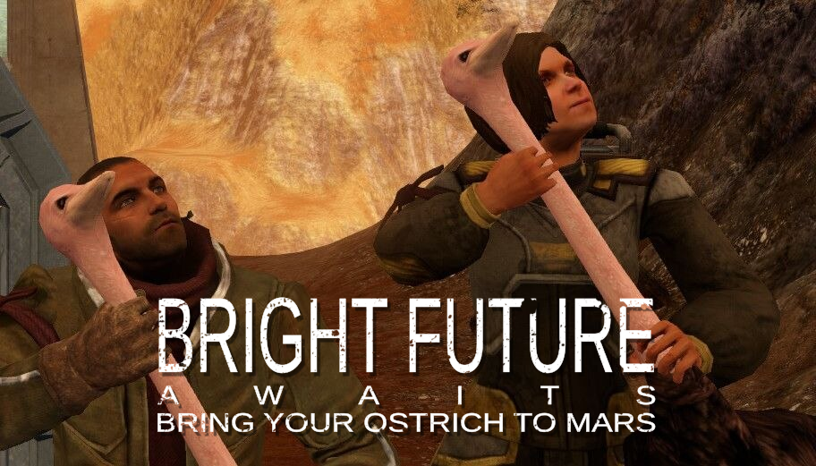

## Introduction for new players

## Is multiplayer alive?

> **Yes, it is!**

We have regular parties once a week and sometimes at random time, too. Things to know if you want to join:

## Short HOWTO

* You need RFG Re-mars-tered. GOG or Steam, clean install without mods
* Join Discord or Steam group. Game is very clunky and requires constant coordination to play.

You absolutely need some channel of communication with players because game is prone to crashing, disconnecting, throwing players in different lobbies, does not have proper server list, and does not allow joining a started match or a match that you dropped out of.

### FactionFiles Discord

See upcoming event time at [FactionFiles](https://www.factionfiles.com/). Join [Discord](https://discord.gg/factionfiles) and visit `#role-selection` channel.

You can also ping relevant roles in `#rfg-matchmaking` (PC, PS, XBOX) anytime if you want to find players 

### Steam Group

There is [Steam RFG Multiplayer Group chat](https://steamcommunity.com/chat/invite/AIMCH8E7) where people play at random times. Join and feel free to ask for some matches anytime!

## Modding

There is a community patch and a mod manager that were used for multiplayer. While they add more content (weapons, maps, player models), bring balance and fixes, the game is very unfriendly to modding. 

**Multiplayer communities ultimately decided to move back to vanilla (unmodded) game because playerbase is very small and any obstacle in bringing new players is not helping.**

Following section is useful for single-player modding or setting up private matches with your friends.

<code>Expand</code>

### Community Patch

Modern mods are designed to work with community patch as base. Download size is several gigabytes so please take some time to prepare.

> You will need at least **40GiB** of free storage space

Use [SyncFaction app](https://github.com/rfg-modding/SyncFaction/releases). It is made to keep players updated and simplify process as much as possible. Download and place .exe in game folder. Run it and let it do the thing.

Why do we need patches and a launcher app?

* [Terraform Patch](https://github.com/CamoRF/Red-Faction-Guerrilla-Terraform-Patch) adds new maps, weapons, rebalance, fixes game crashes and bugs (you can find kilometer-long changelog in description). It also serves as a base for future modding by restructuring some resources
* [Reconstructor](https://github.com/rfg-modding/Reconstructor) is a script loader and a game engine patcher. It fixes some crashes, bugs like hardcoded memory limits, and enables scripting in mods
* RFG is not modding-friendly game. Players will crash if their game files are not the same, that's why we need something to keep everyone updated
* There is no simple way to auto-download new maps as in other games. Currently they are part of the patch and we release updates to add more
* Want to use mods AND play multiplayer? Roll back to unpatched version of the game? SyncFaction lets you switch between versions in 1 click, see [Usage](usage.md)

### FactionFiles Discord

Join [Red Faction Community Discord (FactionFiles)](https://discord.gg/factionfiles)

Feel free to ask for advice in `#rfg-matchmaking` and `#redfactionguerrilla` channels. Also you can hang out with us in one of the voice channels during game night!

